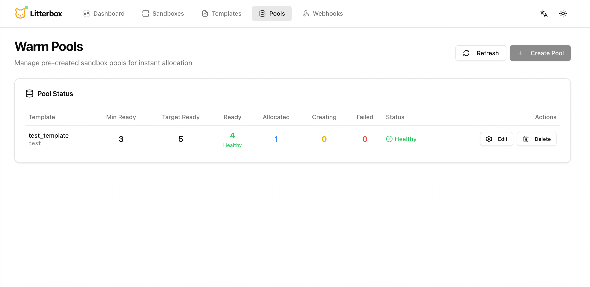
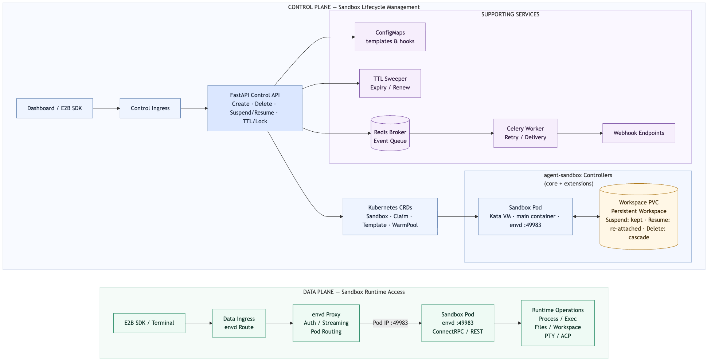

<div align="center">

# 🐱 Litterbox

**Secure sandbox orchestration for AI agents.**

Kubernetes-native. REST and E2B-compatible control plane. Kata Containers isolation.
<br>

[简体中文](README.zh.md) · [API Reference](docs/api-reference.md) · [E2B Guide](orchestrator/docs/API.md) · [Configuration](docs/configuration.md)

</div>

<br>

## What is Litterbox?

Define a template and Litterbox provisions an isolated sandbox on Kubernetes, manages its lifecycle, and exposes terminal, file and HTTP access. Each sandbox runs in its own Kata VM, so untrusted code cannot reach the host or other workloads.

## Features

- **VM isolation** — Kata Containers with a separate guest kernel.
- **Warm pools** — pre-booted sandboxes for fast allocation.
- **Persistent workspace** — one `/workspace` PVC per sandbox, kept across suspend and resume.
- **E2B compatible** — official SDKs can create, connect, pause, resume and kill.
- **Lifecycle** — TTL suspension, lock, delete and level-triggered agent-sandbox controllers.
- **Data plane** — envd exec, files and PTY; expose any sandbox port through Service/Ingress.
- **Webhooks** — async `sandbox_started`, `sandbox_ready` and `sandbox_deleted` events.

## Screenshots

<table>
<tr>
<td></td>
<td></td>
</tr>
<tr>
<td></td>
<td></td>
</tr>
</table>

## Architecture

<a href="docs/imgs/architecture-panorama.png"></a>

The API writes `SandboxTemplate`, `SandboxWarmPool` and `SandboxClaim`; upstream [agent-sandbox](https://github.com/kubernetes-sigs/agent-sandbox) controllers create the Pod and PVC. `envd` on `49983` serves terminal, file and process traffic through the orchestrator proxy. Pause/TTL deletes the Pod but keeps the PVC; resume reattaches it. Annotated version: [docs/architecture.html](docs/architecture.html).

## Quick Start

Requires k3s (or another Kubernetes cluster), Python 3.12+, Node.js 18+.

1. **Install the sandbox backend** — [agent-sandbox](https://github.com/kubernetes-sigs/agent-sandbox) core + extensions and the orchestrator RBAC; see the [backend guide](orchestrator/deploy/AGENT_SANDBOX.md).

2. **Start the API**

   ```bash
   cd orchestrator
   cp config.example.toml config.toml   # set kubeconfig / namespace if needed
   uv sync
   uv run uvicorn orchestrator.main:app --host 0.0.0.0 --port 8080
   ```

3. **Create a template**

   ```bash
   curl -s -X POST http://localhost:8080/api/v1/templates \
     -H "Content-Type: application/json" \
     -d '{"id":"ubuntu","name":"ubuntu","image":"ubuntu:22.04","command":"sleep infinity","cpu_millicores":500,"memory_mb":512,"ttl_seconds":3600}'
   ```

4. **Create a sandbox**

   ```python
   from e2b import Sandbox

   sandbox = Sandbox.create(
       template="ubuntu",
       api_url="http://localhost:8080/e2b",
       domain="localhost",
   )
   print(sandbox.sandbox_id)
   ```

5. **Start the dashboard**

   ```bash
   cd dashboard
   npm install
   npm run dev:local
   ```

   Open http://localhost:5173.

> Set `ORCHESTRATOR__AUTH__BEARER_TOKEN` to require auth. Celery and Redis are only needed for webhooks and warm pools.

## E2B Compatibility

A compatible subset of the E2B control and data planes; official SDKs work directly. Enable the facade with `ORCHESTRATOR__E2B__ENABLED=true`, `ORCHESTRATOR__E2B__API_KEY` and `ORCHESTRATOR__E2B__DOMAIN`, and envd with `ORCHESTRATOR__ENVD__ENABLED=true`.

| Capability | Status |
|---|---|
| `create` / `connect` / `kill` | Supported |
| `pause(keep_memory=False)` | Supported; keeps `/workspace` |
| `pause(keep_memory=True)` | Not supported (`409`) |
| `set_timeout` | Supported; `0` disables expiry |
| Commands, files, PTY | Supported through envd |

Not supported: memory snapshots, fork, E2B template build APIs, E2B volumes and network allow/deny policies. The SDK context manager calls `kill()` on exit; use `pause(keep_memory=False)` to keep the workspace. Full guide: [orchestrator/docs/API.md](orchestrator/docs/API.md).

## API and Configuration

- **REST** — `/api/v1/templates`, `/api/v1/sandboxes`, `/api/v1/pools`, `/api/v1/webhooks`, `/api/v1/sandboxes/:id/{suspend,resume,lock,unlock,renew}`, `/api/v1/sandboxes/:id/envd/*`
- **E2B** — `/e2b/sandboxes`, `/e2b/sandboxes/:id/{connect,pause,timeout}`
- **Config** — `config.toml`, overridden by `ORCHESTRATOR__<SECTION>__<KEY>`; see [docs/configuration.md](docs/configuration.md)
- **API reference** — [docs/api-reference.md](docs/api-reference.md)

## Documentation

[ARCHITECTURE.md](orchestrator/ARCHITECTURE.md) · [E2B Guide](orchestrator/docs/API.md) · [API Reference](docs/api-reference.md) · [Configuration](docs/configuration.md) · [Development](docs/development.md)

---

Issues and pull requests are welcome; see [docs/development.md](docs/development.md) first.
