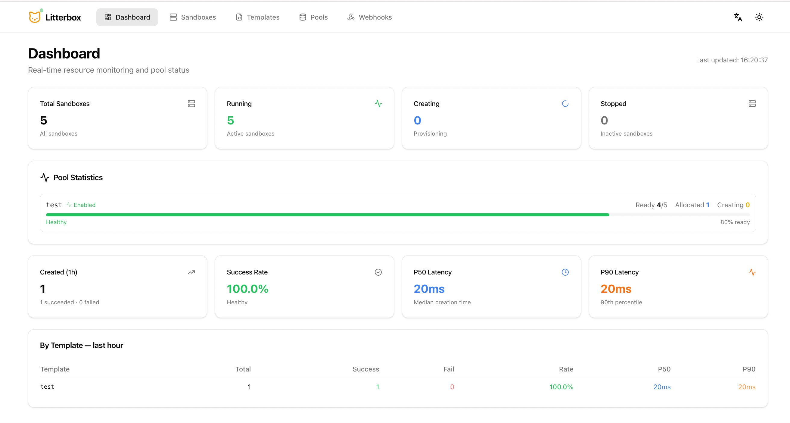
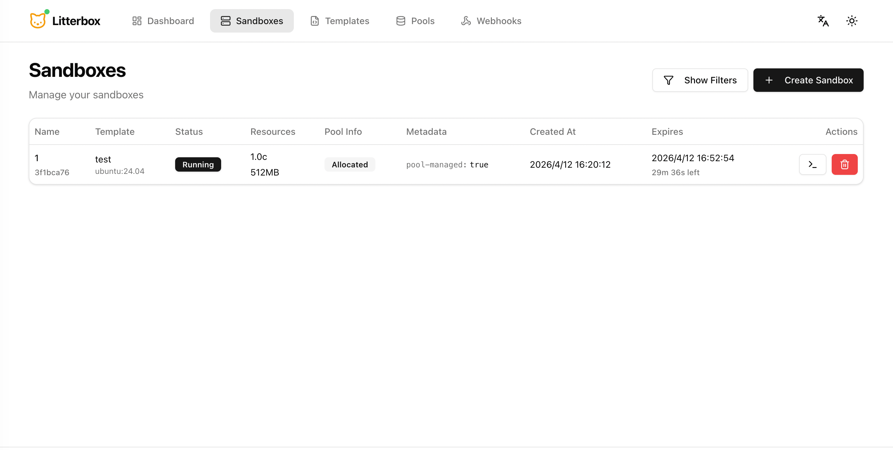
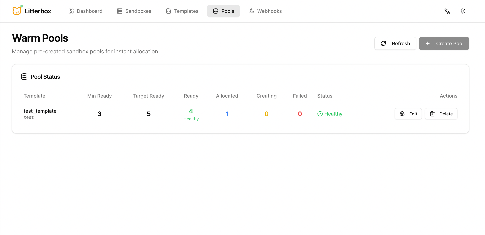
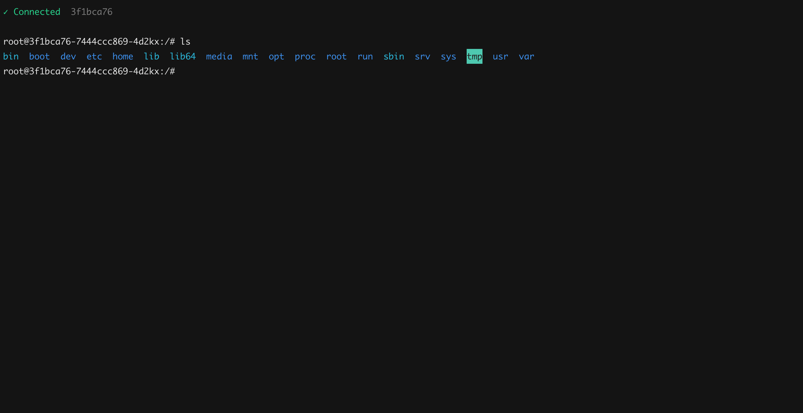
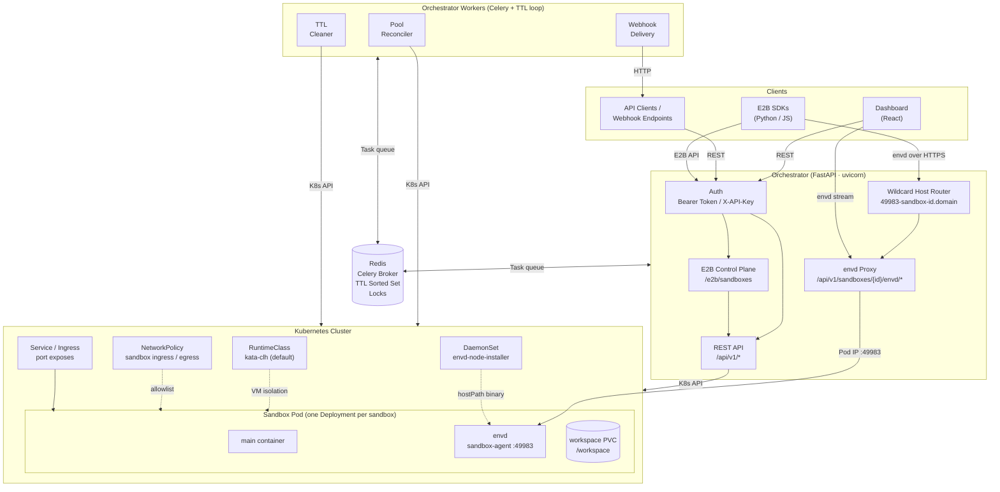

<div align="center">

# 🐱 Litterbox

**Secure sandbox orchestration platform, built for AI Agents.**

Kubernetes-native REST API and an E2B-compatible sandbox control plane. Runs untrusted code in VM-level isolated environments via Kata Containers.
<br>

[简体中文](README.zh.md) · [API Reference](docs/api-reference.md) · [E2B API Guide](orchestrator/docs/API.md) · [Configuration](docs/configuration.md)

</div>

<br>

## What is Litterbox?

Litterbox turns Kubernetes into a secure sandbox runtime. Define a template (image, resources, env), and Litterbox provisions isolated Pods, manages lifecycle, and exposes services on demand. Each sandbox runs in a VM with its own guest kernel — untrusted code or files cannot escape to the host or affect other workloads.

It exposes a private REST API under `/api/v1` and an E2B-compatible control plane under `/e2b`, so existing E2B SDKs can create, connect, pause and kill sandboxes without code changes.

```text
POST /e2b/sandboxes     →  E2B SDK compatible: create / connect / pause / kill
POST /api/v1/sandboxes  →  native REST control plane, running sandbox in < 200ms (warm pool)
                         →  command exec, file I/O and PTY through the envd data plane
                         →  auto-suspended when TTL expires (workspace retained)
```

<br>

## Core Capabilities

<table>
<tr>
<td width="140"><strong>Warm Pool</strong></td>
<td>Pre-boots sandboxes per template. Allocation latency as low as <strong>&lt; 50ms</strong>.</td>
</tr>
<tr>
<td><strong>Lifecycle</strong></td>
<td>TTL auto-suspension keeps <code>/workspace</code>; permanent deletion on demand.</td>
</tr>
<tr>
<td><strong>E2B Compatible</strong></td>
<td>Official E2B SDKs drive the <code>/e2b</code> control plane: create, connect, pause, resume, timeout and kill.</td>
</tr>
<tr>
<td><strong>Terminal</strong></td>
<td>Web terminal, command exec and PTY sessions through the envd data plane.</td>
</tr>
<tr>
<td><strong>File System</strong></td>
<td>Read and write files inside a sandbox through envd (SDK or REST proxy).</td>
</tr>
<tr>
<td><strong>Expose</strong></td>
<td>Expose any in-sandbox port to external network access.</td>
</tr>
<tr>
<td><strong>Webhooks</strong></td>
<td><code>sandbox_started</code> · <code>sandbox_ready</code> · <code>sandbox_deleted</code> events. Async delivery with configurable timeout and retry.</td>
</tr>
</table>

<br>

## Screenshots

<table>
<tr>
<td></td>
<td></td>
</tr>
<tr>
<td></td>
<td></td>
</tr>
</table>

<br>

## Architecture



**Control plane.** The private REST API under `/api/v1` manages templates, warm pools, webhooks, port exposes and sandbox lifecycle. The E2B-compatible routes under `/e2b/sandboxes` adapt the same services to the official E2B SDK. Templates, pools and webhooks live in ConfigMaps; sandbox state lives in Deployment labels and annotations; TTL schedules and pool locks live in Redis. Celery workers reconcile warm pools and deliver webhooks; a separate TTL loop suspends expired sandboxes.

**Data plane.** Every sandbox is a Deployment with one `main` container. When envd is enabled, the `envd-node-installer` DaemonSet places the `sandbox-agent` binary on each Kata node, the orchestrator mounts it into the pod, and a `postStart` hook starts it on port `49983`. Command execution, file I/O and PTY sessions all go through envd. The orchestrator authenticates and proxies that traffic to the sandbox Pod IP, either path-based (`/api/v1/sandboxes/{id}/envd/*`) or via E2B host routing (`49983-{sandbox-id}.{domain}`).

**Isolation and storage.** Sandbox Pods run under the `kata-clh` RuntimeClass by default, giving each sandbox its own guest kernel. Each sandbox also gets a `/workspace` PVC (LVM-backed by default), which survives pause/resume and is deleted only on permanent kill. Where installed, NetworkPolicies restrict sandbox ingress to the orchestrator and Traefik, and egress to DNS, the billing proxy and the public internet.

### Prerequisites

| | Version |
|---|---|
| Kubernetes | `k3s recommended` |
| Docker Compose | `v2+` |
| Node.js | `18+` |
| Python | `3.12+` |

### 1. Start the Backend

```bash
cd orchestrator
cp .env.example .env      # → edit KUBECONFIG, K8S_NAMESPACE, BASE_DOMAIN
docker compose up --build
```

Verify:

```bash
curl http://localhost:8080/health
# {"success": true, "message": "Litterbox API is running"}
```

### 2. Start the Dashboard

```bash
cd dashboard
cp .env.example .env      # → set VITE_API_BASE_URL and VITE_API_BEARER_TOKEN
npm install && npm run dev
```

Open **http://localhost:5173**

> **Auth:** If the backend has `ORCHESTRATOR__AUTH__BEARER_TOKEN` set, add the same value to `VITE_API_BEARER_TOKEN` in `dashboard/.env`. Leave it empty for open access.

### 3. Create Your First Sandbox

```bash
# 1. Create a template
curl -s -X POST http://localhost:8080/api/v1/templates \
  -H "Content-Type: application/json" \
  -d '{
    "id": "ubuntu",
    "name": "ubuntu",
    "image": "ubuntu:22.04",
    "command": "sleep infinity",
    "cpu_millicores": 500,
    "memory_mb": 512,
    "ttl_seconds": 3600
  }' | jq .data.id
# → "ubuntu"

# 2. Spin up a sandbox from the template
curl -s -X POST http://localhost:8080/api/v1/sandboxes \
  -H "Content-Type: application/json" \
  -d '{"template_id": "ubuntu"}' | jq .data.id
# → "xyz789"
```

To execute commands, read/write files or open a PTY, use the E2B SDK or the envd proxy — see [E2B Compatibility](#e2b-compatibility). envd must be installed and enabled first; it is off by default.


## API

| Action | Method | Path |
|---|---|---|
| Create template | `POST` | `/api/v1/templates` |
| Create sandbox | `POST` | `/api/v1/sandboxes` |
| Suspend / resume sandbox | `POST` | `/api/v1/sandboxes/:id/suspend` · `/api/v1/sandboxes/:id/resume` |
| Renew TTL | `POST` | `/api/v1/sandboxes/:id/renew` |
| Expose port | `POST` | `/api/v1/sandboxes/:id/exposes` |
| Create warm pool | `POST` | `/api/v1/pools/:template_id` |
| Register webhook | `POST` | `/api/v1/webhooks` |
| E2B create / get / kill | `POST` `GET` `DELETE` | `/e2b/sandboxes` · `/e2b/sandboxes/:id` |
| E2B connect / pause / timeout | `POST` | `/e2b/sandboxes/:id/connect` · `/pause` · `/timeout` |
| envd data plane (SDK) | `HTTP / Connect RPC` | `49983-:id.<e2b.domain>` |
| envd proxy (diagnostics) | `HTTP / Connect RPC` | `/api/v1/sandboxes/:id/envd/*` |

Each resource group supports full CRUD (`GET` / `PATCH` / `DELETE`).

> 📖 **Full API reference** → [docs/api-reference.md](docs/api-reference.md)

<br>

## E2B Compatibility

Litterbox implements the subset of the E2B control plane and envd data plane needed to run the official E2B SDKs. End-to-end testing has been done with [`e2b`](https://pypi.org/project/e2b/) Python SDK 2.46; compatible 2.x releases should work.

### Before You Start

- Set `ORCHESTRATOR__E2B__ENABLED=true`.
- Set `ORCHESTRATOR__E2B__API_KEY` to the key clients present as `X-API-Key`. When empty, the orchestrator bearer token is accepted instead.
- Point `ORCHESTRATOR__E2B__DOMAIN` at a wildcard domain (for example `sandbox.runlet.cn`) whose `*.sandbox.runlet.cn` DNS record and TLS certificate route to the orchestrator. The SDK reaches sandbox data planes at `49983-{sandboxID}.{domain}`.
- Enable and install envd on the Kata nodes (`ORCHESTRATOR__ENVD__ENABLED=true`, see [orchestrator/k8s/envd](orchestrator/k8s/envd/README.md)).
- Create the template first through `/api/v1/templates`; E2B `Sandbox.create(template=...)` only selects an existing template and does not build images.

### Python SDK

```bash
pip install e2b
```

```python
from e2b import Sandbox

config = {
    "api_url": "https://orchestrator.example.com/e2b",
    "domain": "sandbox.example.com",
    "api_key": "<E2B_API_KEY>",
}

sandbox = Sandbox.create(
    template="ubuntu",
    timeout=300,
    metadata={"job_id": "1001"},
    **config,
)

# Commands, files and PTY go through the envd data plane.
print(sandbox.commands.run("uname -a").stdout)
sandbox.files.write("/workspace/notes.txt", "hello")
print(sandbox.files.read("/workspace/notes.txt"))

# Scale to zero but keep the /workspace PVC.
sandbox.pause(keep_memory=False)

# Reconnect; this resumes the paused sandbox.
sandbox = Sandbox.connect(sandbox.sandbox_id, **config)

sandbox.set_timeout(600)

# Permanent: deletes the Deployment and the workspace PVC.
sandbox.kill()
```

`envdAccessToken` from the create response is used automatically by the SDK. If you talk to envd with a plain HTTP client instead, send it as `X-Access-Token`; do not call the Connect RPC endpoints with bare JSON.

### Supported Semantics

| E2B capability | Litterbox behavior |
|---|---|
| `Sandbox.create` / `connect` / `kill`, sandbox lookup | Supported; `connect` resumes a suspended sandbox |
| `Sandbox.pause(keep_memory=False)` | Supported; scales the Deployment to zero, keeps `/workspace` |
| `Sandbox.set_timeout` | Supported; `0` means no expiry |
| `commands.run`, `files.read/write`, PTY streams | Supported through envd |
| Workspace persistence | `/workspace` survives pause/connect, deleted only on `kill()` |

Not supported: `pause(keep_memory=True)` memory snapshots (returns `409`), snapshots, fork, template builds, E2B volumes, network allow/deny policies (`allow_internet_access=false` returns `400`), and traffic access tokens.

> **Note:** the SDK's context manager calls `kill()` on exit. Use explicit `pause(keep_memory=False)` when the workspace should outlive the session.
> 📖 **Full E2B guide, raw endpoints and troubleshooting** → [orchestrator/docs/API.md](orchestrator/docs/API.md)

<br>

## Configuration

Backend is configured via `config.toml` with environment variable overrides (`ORCHESTRATOR__<SECTION>__<KEY>`).

| Variable | Default | Description |
|---|---|---|
| `ORCHESTRATOR__KUBERNETES__KUBECONFIG` | *empty (in-cluster)* | Path to kubeconfig; unset = in-cluster auth |
| `ORCHESTRATOR__KUBERNETES__NAMESPACE` | `default` | Namespace for sandbox resources |
| `ORCHESTRATOR__KUBERNETES__RUNTIME_CLASS` | `kata-clh` | RuntimeClass applied if it exists in the cluster (VM isolation) |
| `ORCHESTRATOR__WORKSPACE__STORAGE_CLASS` | `litterbox-workspace-lvm` | StorageClass for per-sandbox `/workspace` PVCs |
| `ORCHESTRATOR__ENVD__ENABLED` | `false` | Inject and start the envd data plane in sandbox pods |
| `ORCHESTRATOR__ENVD__VERSION` | `0.1.0` | envd version, also used as the node selector label |
| `ORCHESTRATOR__E2B__ENABLED` | `true` | Expose the E2B-compatible control plane under `/e2b` |
| `ORCHESTRATOR__E2B__API_KEY` | *empty* | E2B `X-API-Key`; falls back to the bearer token when empty |
| `ORCHESTRATOR__E2B__DOMAIN` | `sandbox.runlet.cn` | Wildcard data-plane domain (`49983-:id.<domain>`) |
| `ORCHESTRATOR__SANDBOX__BASE_DOMAIN` | `runlet.cn` | Wildcard domain for HTTP exposes |
| `ORCHESTRATOR__SANDBOX__MAX_SANDBOXES` | `1000` | Max concurrent sandboxes |
| `ORCHESTRATOR__TTL__DEFAULT_TTL_SECONDS` | `1800` | Default sandbox lifetime (seconds) |
| `ORCHESTRATOR__CELERY__BROKER_URL` | `redis://127.0.0.1:6379/2` | Celery broker Redis URL |
| `ORCHESTRATOR__AUTH__BEARER_TOKEN` | *empty* | Optional shared Bearer token for `/api/v1/*` and E2B fallback auth |

> 📖 **Full configuration reference** → [docs/configuration.md](docs/configuration.md)

<br>

## Documentation

| | |
|---|---|
| [**ARCHITECTURE.md**](orchestrator/ARCHITECTURE.md) | Internal design, data flow, component boundaries |
| [**E2B API Guide**](orchestrator/docs/API.md) | E2B compatibility, SDK examples, raw endpoints |
| [**docs/api-reference.md**](docs/api-reference.md) | Full API reference |
| [**docs/configuration.md**](docs/configuration.md) | All configuration options |
| [**docs/development.md**](docs/development.md) | Local development |

<br>

---

## Contributing

Issues and pull requests are welcome. Please read [docs/development.md](docs/development.md) first.
