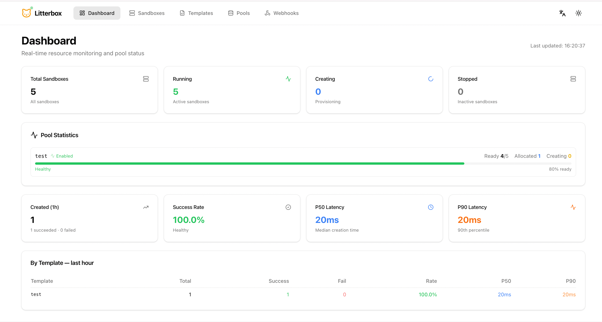
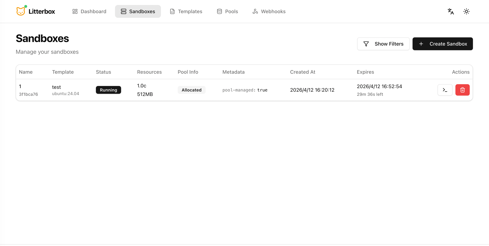
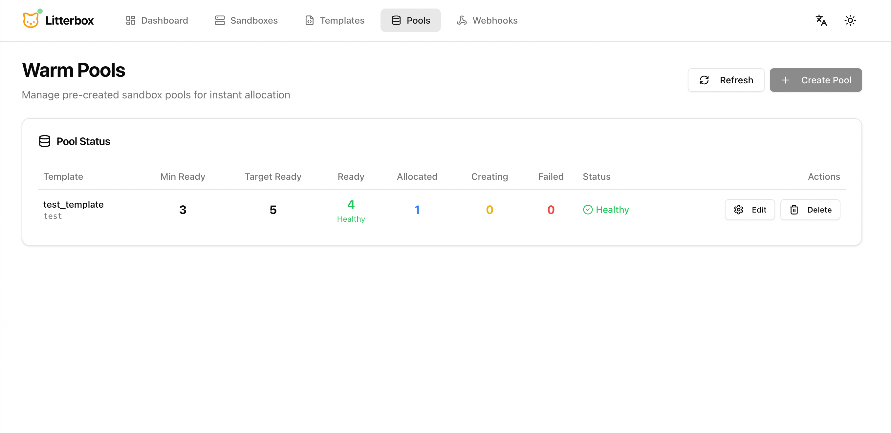
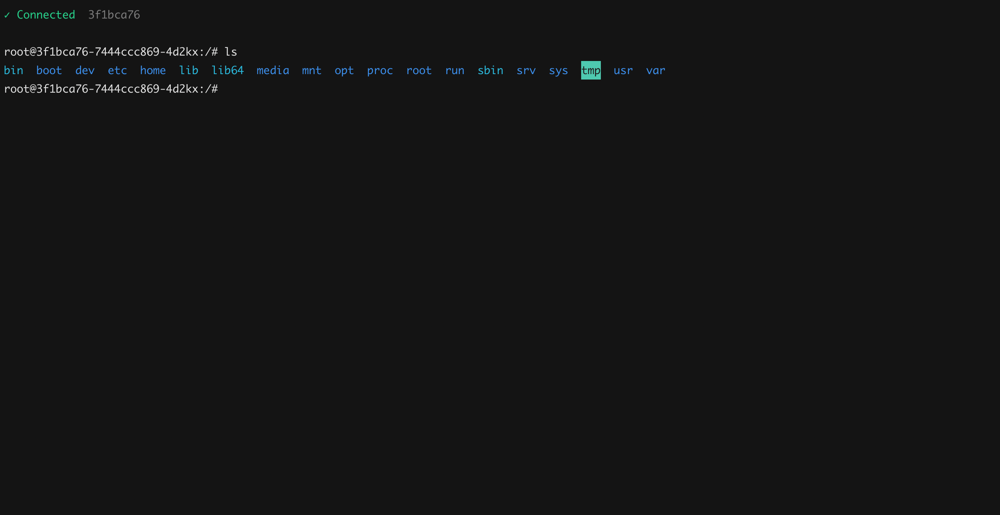
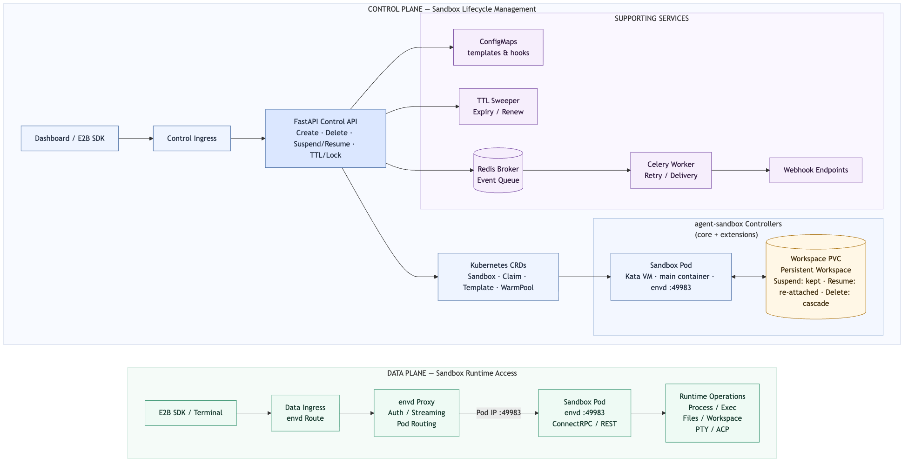

<div align="center">

# 🐱 Litterbox

**面向 AI Agent 的安全沙箱编排。**

Kubernetes 原生 · REST + E2B 兼容控制面 · Kata Containers 隔离
<br>

[English](README.md) · [API 参考](docs/api-reference.md) · [E2B 指南](orchestrator/docs/API.md) · [配置](docs/configuration.md)

</div>

<br>

## Litterbox 是什么？

定义一个模板，Litterbox 就会在 Kubernetes 上创建隔离沙箱、管理其生命周期，并按需暴露终端、文件和 HTTP 访问。每个沙箱运行在独立的 Kata VM 中，不可信代码无法访问宿主机或其他工作负载。

## 核心能力

- **VM 隔离** — Kata Containers，独立 guest kernel。
- **预热池** — 预启动沙箱，降低分配延迟。
- **持久工作区** — 每沙箱一个 `/workspace` PVC，暂停/恢复后保留。
- **E2B 兼容** — 官方 SDK 可直接 create / connect / pause / resume / kill。
- **生命周期** — TTL 暂停、锁定、删除，agent-sandbox 控制器水平触发调谐。
- **数据面** — envd 提供命令、文件和 PTY；任意端口可通过 Service/Ingress 暴露。
- **Webhook** — 异步 `sandbox_started`、`sandbox_ready`、`sandbox_deleted` 事件。

## 截图

<table>
<tr>
<td></td>
<td></td>
</tr>
<tr>
<td></td>
<td></td>
</tr>
</table>

## 架构

<a href="docs/imgs/architecture-panorama.png"></a>

API 写入 `SandboxTemplate`、`SandboxWarmPool` 和 `SandboxClaim`；上游 [agent-sandbox](https://github.com/kubernetes-sigs/agent-sandbox) 控制器创建 Pod 和 PVC。沙箱内 `49983` 端口的 envd 通过 orchestrator 代理提供终端、文件和进程访问。暂停/TTL 到期只删除 Pod、保留 PVC，恢复时重新挂载。完整标注版：[docs/architecture.html](docs/architecture.html)。

## 快速开始

需要 k3s（或其他 Kubernetes 集群）、Python 3.12+、Node.js 18+。

1. **安装沙箱后端** — [agent-sandbox](https://github.com/kubernetes-sigs/agent-sandbox) core + extensions 和 orchestrator RBAC，见 [后端说明](orchestrator/deploy/AGENT_SANDBOX.md)。

2. **启动 API**

   ```bash
   cd orchestrator
   cp config.example.toml config.toml   # 按需设置 kubeconfig / namespace
   uv sync
   uv run uvicorn orchestrator.main:app --host 0.0.0.0 --port 8080
   ```

3. **创建模板**

   ```bash
   curl -s -X POST http://localhost:8080/api/v1/templates \
     -H "Content-Type: application/json" \
     -d '{"id":"ubuntu","name":"ubuntu","image":"ubuntu:22.04","command":"sleep infinity","cpu_millicores":500,"memory_mb":512,"ttl_seconds":3600}'
   ```

4. **创建沙箱**

   ```python
   from e2b import Sandbox

   sandbox = Sandbox.create(
       template="ubuntu",
       api_url="http://localhost:8080/e2b",
       domain="localhost",
   )
   print(sandbox.sandbox_id)
   ```

5. **启动控制台**

   ```bash
   cd dashboard
   npm install
   npm run dev:local
   ```

   打开 http://localhost:5173。

> 设置 `ORCHESTRATOR__AUTH__BEARER_TOKEN` 后需要 Bearer 认证；Celery 和 Redis 只用于 Webhook 和预热池。

## E2B 兼容

兼容 E2B 控制面和数据面的一个子集，官方 SDK 可直接使用。通过 `ORCHESTRATOR__E2B__ENABLED=true`、`ORCHESTRATOR__E2B__API_KEY` 和 `ORCHESTRATOR__E2B__DOMAIN` 开启控制面，通过 `ORCHESTRATOR__ENVD__ENABLED=true` 开启 envd。

| 能力 | 状态 |
|---|---|
| `create` / `connect` / `kill` | 支持 |
| `pause(keep_memory=False)` | 支持；保留 `/workspace` |
| `pause(keep_memory=True)` | 不支持（`409`） |
| `set_timeout` | 支持；`0` 关闭到期 |
| 命令 / 文件 / PTY | 通过 envd 支持 |

不支持：内存快照、fork、E2B 模板构建 API、E2B volumes、网络 allow/deny 策略。SDK 上下文管理器退出时会调用 `kill()`；要保留工作区请用 `pause(keep_memory=False)`。完整指南：[orchestrator/docs/API.md](orchestrator/docs/API.md)。

## API 与配置

- **REST** — `/api/v1/templates`、`/api/v1/sandboxes`、`/api/v1/pools`、`/api/v1/webhooks`、`/api/v1/sandboxes/:id/{suspend,resume,lock,unlock,renew}`、`/api/v1/sandboxes/:id/envd/*`
- **E2B** — `/e2b/sandboxes`、`/e2b/sandboxes/:id/{connect,pause,timeout}`
- **配置** — `config.toml`，可被 `ORCHESTRATOR__<SECTION>__<KEY>` 环境变量覆盖；见 [docs/configuration.md](docs/configuration.md)
- **API 参考** — [docs/api-reference.md](docs/api-reference.md)

## 文档

[ARCHITECTURE.md](orchestrator/ARCHITECTURE.md) · [E2B 指南](orchestrator/docs/API.md) · [API 参考](docs/api-reference.md) · [配置](docs/configuration.md) · [开发](docs/development.md)

---

欢迎提交 Issue 和 PR；请先阅读 [docs/development.md](docs/development.md)。
