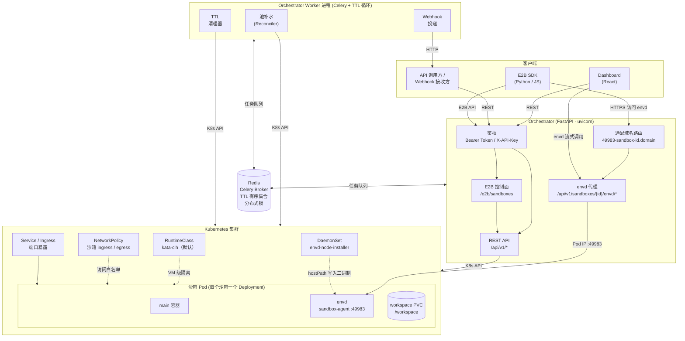

<div align="center">

# 🐱 Litterbox

**为 AI Agent 设计的安全沙箱编排平台。**

基于 Kubernetes 的 REST API 与 E2B 兼容沙箱控制面，通过 Kata Containers 在虚拟机级别的隔离环境中运行不可信代码。
<br>

[English](README.md) · [API 文档](docs/api-reference.md) · [E2B API 指南](orchestrator/docs/API.md) · [配置说明](docs/configuration.md)

</div>

<br>

## Litterbox 是什么？

Litterbox 将 Kubernetes 变为安全的沙箱运行环境。用户只需定义模板（镜像、资源、环境变量），Litterbox 便会自动创建隔离 Pod、管理生命周期并按需暴露服务。每个沙箱均运行在具备独立 Guest 环境的虚拟机中，确保不可信代码或文件无法影响宿主机或其他工作负载。

它同时提供两套控制面：`/api/v1` 下的私有 REST API，以及 `/e2b` 下兼容 E2B 的控制面。现有 E2B SDK 无需改代码即可创建、连接、暂停和销毁沙箱。

```text
POST /e2b/sandboxes     →  兼容 E2B SDK：创建 / 连接 / 暂停 / 销毁
POST /api/v1/sandboxes  →  原生 REST 控制面，< 200ms 拿到运行中的沙箱（预热池）
                         →  通过 envd 数据面执行命令、读写文件、PTY 终端
                         →  TTL 到期自动暂停并保留 workspace
```

<br>

## 核心能力

<table>
<tr>
<td width="140"><strong>沙箱池化</strong></td>
<td>按模板预启动沙箱。分配延迟可低至<strong>< 50ms</strong></td>
</tr>
<tr>
<td><strong>生命周期</strong></td>
<td>TTL 到期自动暂停并保留 <code>/workspace</code>，也可主动永久销毁。</td>
</tr>
<tr>
<td><strong>E2B 兼容</strong></td>
<td>官方 E2B SDK 可直接驱动 <code>/e2b</code> 控制面：创建、连接、暂停、恢复、续期和销毁。</td>
</tr>
<tr>
<td><strong>交互式终端</strong></td>
<td>通过 envd 数据面提供 Web 终端、命令执行和 PTY 会话。</td>
</tr>
<tr>
<td><strong>文件系统</strong></td>
<td>通过 envd 读写沙箱内文件（SDK 或 REST 代理）。</td>
</tr>
<tr>
<td><strong>服务暴露</strong></td>
<td>可暴露沙箱内的任意端口服务到外部网络访问。</td>
</tr>
<tr>
<td><strong>Webhook</strong></td>
<td>支持<code>sandbox_started</code> · <code>sandbox_ready</code> · <code>sandbox_deleted</code> 事件。异步投递，可配置超时/重试。</td>
</tr>
</table>

<br>

## 截图

<table>
<tr>
<td></td>
<td></td>
</tr>
<tr>
<td></td>
<td></td>
</tr>
</table>

<br>

##  架构



**控制面。** `/api/v1` 私有 REST API 管理模板、预热池、Webhook、端口暴露和沙箱生命周期；`/e2b/sandboxes` 兼容路由把同一套服务适配给官方 E2B SDK。模板、池和 Webhook 存在 ConfigMap 中，沙箱状态写在 Deployment 的标签和注解里，TTL 调度和池锁存在 Redis 中。Celery Worker 负责池补水和 Webhook 投递，独立的 TTL 循环负责暂停过期沙箱。

**数据面。** 每个沙箱是一个 Deployment，包含一个 `main` 容器。启用 envd 后，`envd-node-installer` DaemonSet 把 `sandbox-agent` 二进制安装到每个 Kata 节点，orchestrator 将其挂载进 Pod，并由 `postStart` 在 `49983` 端口启动。命令执行、文件读写和 PTY 都走 envd；orchestrator 负责鉴权并把流量代理到沙箱 Pod IP，路径为 `/api/v1/sandboxes/{id}/envd/*`，E2B 场景下则通过 `49983-{sandbox-id}.{domain}` 的 Host 路由。

**隔离与存储。** 沙箱 Pod 默认使用 `kata-clh` RuntimeClass，每个沙箱拥有独立 Guest 内核。每个沙箱还会创建 `/workspace` PVC（默认 LVM 后端），暂停/恢复后数据保留，只有永久销毁时才删除。安装 NetworkPolicy 后，沙箱入向只允许 orchestrator 和 Traefik，出向只允许 DNS、计费代理和公网。

### 前置条件

| | 版本         |
|---|------------|
| Kubernetes | `推荐使用 k3s` |
| Docker Compose | `v2+`      |
| Node.js | `18+`      |
| Python  | `3.12+`    |

### 1、 启动后端

```bash
cd orchestrator
cp .env.example .env      # → 编辑 KUBECONFIG、K8S_NAMESPACE、BASE_DOMAIN
docker compose up --build
```

验证：

```bash
curl http://localhost:8080/health
# {"success": true, "message": "Litterbox API is running"}
```

### 2、启动控制台

```bash
cd dashboard
cp .env.example .env      # → 设置 VITE_API_BASE_URL 和 VITE_API_BEARER_TOKEN
npm install && npm run dev
```

访问 **http://localhost:5173**

> **鉴权：** 若后端配置了 `ORCHESTRATOR__AUTH__BEARER_TOKEN`，需在 `dashboard/.env` 中将 `VITE_API_BEARER_TOKEN` 设为相同的值。留空则不启用鉴权。

### 3️⃣ 创建第一个沙箱

```bash
# 1. 创建模板
curl -s -X POST http://localhost:8080/api/v1/templates \
  -H "Content-Type: application/json" \
  -d '{
    "id": "ubuntu",
    "name": "ubuntu",
    "image": "ubuntu:22.04",
    "command": "sleep infinity",
    "cpu_millicores": 500,
    "memory_mb": 512,
    "ttl_seconds": 3600
  }' | jq .data.id
# → "ubuntu"

# 2. 基于模板创建沙箱
curl -s -X POST http://localhost:8080/api/v1/sandboxes \
  -H "Content-Type: application/json" \
  -d '{"template_id": "ubuntu"}' | jq .data.id
# → "xyz789"
```

执行命令、读写文件或打开 PTY 终端请使用 E2B SDK 或 envd 代理，见 [E2B 兼容](#e2b-兼容)。envd 需要先安装并启用，默认关闭。

## E2B 兼容

Litterbox 实现了 E2B 控制面和 envd 数据面的兼容子集，可直接运行官方 E2B SDK。当前已使用 [`e2b`](https://pypi.org/project/e2b/) Python SDK 2.46 完成端到端验证，兼容的 2.x 版本应可正常工作。

### 使用前提

- 设置 `ORCHESTRATOR__E2B__ENABLED=true`。
- 设置 `ORCHESTRATOR__E2B__API_KEY`，客户端通过 `X-API-Key` 携带。留空时接受 orchestrator 的 Bearer Token。
- 将 `ORCHESTRATOR__E2B__DOMAIN` 指向一个通配域名（例如 `sandbox.runlet.cn`），并让 `*.sandbox.runlet.cn` 的 DNS 和 TLS 证书路由到 orchestrator。SDK 会通过 `49983-{sandboxID}.{domain}` 访问沙箱数据面。
- 在 Kata 节点上安装并启用 envd（`ORCHESTRATOR__ENVD__ENABLED=true`，参见 [orchestrator/k8s/envd](orchestrator/k8s/envd/README.md)）。
- 先通过 `/api/v1/templates` 创建模板；E2B `Sandbox.create(template=...)` 只选择已有模板，不构建镜像。

### Python SDK

```bash
pip install e2b
```

```python
from e2b import Sandbox

config = {
    "api_url": "https://orchestrator.example.com/e2b",
    "domain": "sandbox.example.com",
    "api_key": "<E2B_API_KEY>",
}

sandbox = Sandbox.create(
    template="ubuntu",
    timeout=300,
    metadata={"job_id": "1001"},
    **config,
)

# 命令、文件和 PTY 都通过 envd 数据面。
print(sandbox.commands.run("uname -a").stdout)
sandbox.files.write("/workspace/notes.txt", "hello")
print(sandbox.files.read("/workspace/notes.txt"))

# 缩容到 0，但保留 /workspace PVC。
sandbox.pause(keep_memory=False)

# 重新连接会自动恢复已暂停的沙箱。
sandbox = Sandbox.connect(sandbox.sandbox_id, **config)

sandbox.set_timeout(600)

# 永久删除：同时删除 Deployment 和 workspace PVC。
sandbox.kill()
```

创建响应中的 `envdAccessToken` 会被 SDK 自动使用。如果改用普通 HTTP 客户端访问 envd，请通过 `X-Access-Token` 携带；不要把 envd 的 Connect RPC 接口当成裸 JSON REST 调用。

### 支持范围

| E2B 能力 | Litterbox 行为 |
|---|---|
| `Sandbox.create` / `connect` / `kill`、沙箱查询 | 支持；`connect` 会恢复已暂停沙箱 |
| `Sandbox.pause(keep_memory=False)` | 支持；Deployment 缩容到 0，保留 `/workspace` |
| `Sandbox.set_timeout` | 支持；`0` 表示不超时 |
| `commands.run`、`files.read/write`、PTY 流 | 通过 envd 支持 |
| workspace 持久化 | 暂停/恢复后保留，仅 `kill()` 时删除 |

暂不支持：`pause(keep_memory=True)` 内存快照（返回 `409`）、snapshots、fork、模板构建、E2B volumes、网络 allow/deny 策略（`allow_internet_access=false` 返回 `400`）以及 traffic access token。

> **注意：** E2B SDK 的 context manager 退出时会调用 `kill()`。需要保留 workspace 时请显式调用 `pause(keep_memory=False)`。
> 📖 **完整 E2B 指南、原始接口和排错** → [orchestrator/docs/API.md](orchestrator/docs/API.md)

## 文档

| |               |
|---|---------------|
| [**ARCHITECTURE.md**](orchestrator/ARCHITECTURE.md) | 内部设计、数据流、组件边界 |
| [**E2B API 指南**](orchestrator/docs/API.md) | E2B 兼容性、SDK 示例、原始接口 |
| [**docs/api-reference.md**](docs/api-reference.md) | API接口文档       |
| [**docs/configuration.md**](docs/configuration.md) | 配置项说明         |
| [**docs/development.md**](docs/development.md) | 本地开发          |

<br>

---

## 贡献

欢迎提交 Issue 和 Pull Request，请先阅读 [docs/development.md](docs/development.md)。

