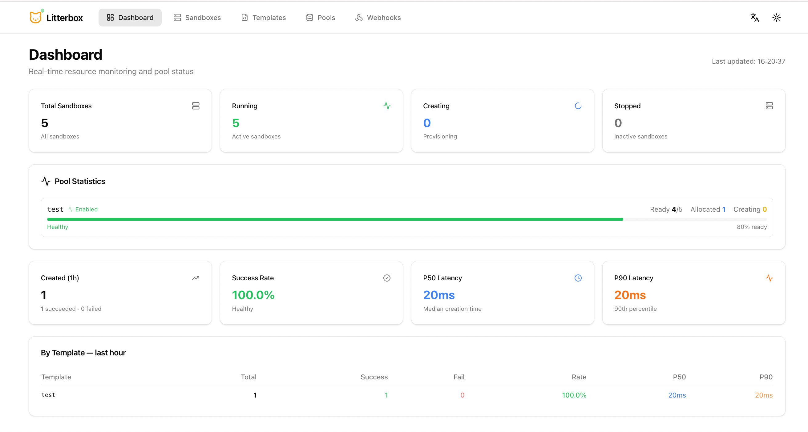
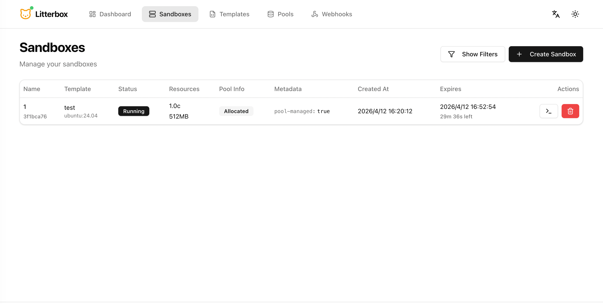
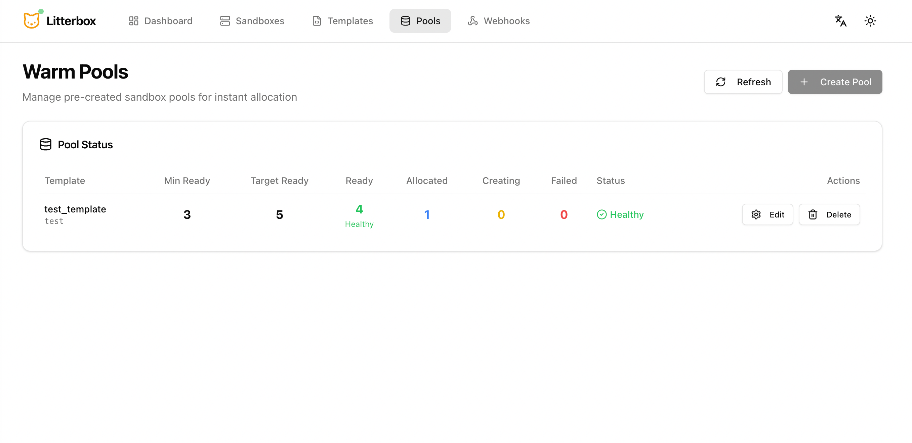
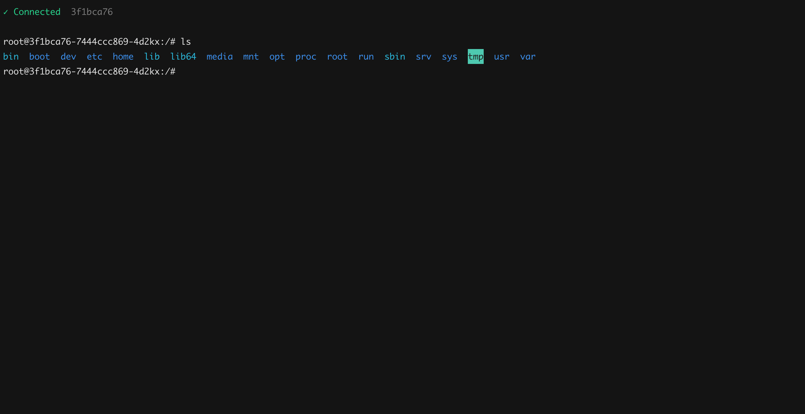
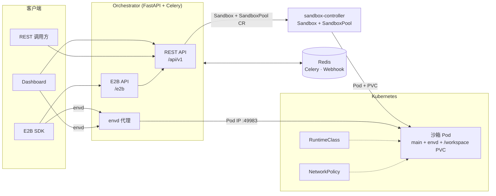

<div align="center">

# 🐱 Litterbox

**为 AI Agent 设计的安全沙箱编排平台。**

基于 Kubernetes 的 REST API 与 E2B 兼容控制面，通过 Kata Containers 实现虚拟机级别的隔离。
<br>

[English](README.md) · [API 文档](docs/api-reference.md) · [E2B 指南](orchestrator/docs/API.md) · [配置说明](docs/configuration.md) · [沙箱控制器](controller/README.md)

</div>

<br>

## Litterbox 是什么？

定义模板后，Litterbox 会在 Kubernetes 上创建隔离沙箱、管理生命周期并按需暴露服务。每个沙箱运行在独立虚拟机中，拥有自己的 Guest 内核，不可信代码无法影响宿主机或其他工作负载。

```text
POST /e2b/sandboxes       使用 E2B SDK 创建沙箱
POST /api/v1/sandboxes    原生 REST 控制面
                          通过 envd 执行命令、读写文件、开 PTY
                          TTL 到期暂停，主动调用时永久删除
```

<br>

## 核心能力

| 能力 | 说明 |
|---|---|
| **虚拟机隔离** | 沙箱运行在 Kata Containers RuntimeClass 下，拥有独立 Guest 内核。 |
| **预热池** | 按模板预启动沙箱，分配延迟低。 |
| **持久工作区** | 每个沙箱一个 `/workspace` PVC，暂停/恢复后数据保留。 |
| **E2B 兼容** | 官方 E2B SDK 可创建、连接、暂停、恢复和销毁沙箱。 |
| **CRD 生命周期** | 基于 `Sandbox` CRD 和控制器：声明式收敛、informer 本地缓存读取、Pod 自愈、控制器驱动的 TTL。 |
| **生命周期** | TTL 自动暂停、池补水、沙箱锁、永久删除。 |
| **终端与文件** | 通过 envd 数据面执行命令、读写文件和 PTY。 |
| **端口暴露** | 通过 Service + Ingress 暴露沙箱端口。 |
| **Webhook** | 异步投递 `sandbox_started`、`sandbox_ready`、`sandbox_deleted`。 |

<br>

## 截图

<table>
<tr>
<td></td>
<td></td>
</tr>
<tr>
<td></td>
<td></td>
</tr>
</table>

<br>

## 架构



- **控制面。** `/api/v1` 管理模板、池、Webhook、端口暴露和沙箱生命周期；`/e2b` 把同一套服务适配给 E2B SDK。模板、池和 Webhook 的元数据存在 ConfigMap 中。
- **沙箱生命周期。** API 只写入 `Sandbox` 和 `SandboxPool` 自定义资源；控制器负责创建和回收 Pod/PVC、维护 `status.phase`、处理 TTL 到期、自动修复被删除的 Pod，并维护预热池供给。REST 和 E2B 客户端不直接操作 Kubernetes 工作负载。预热池分配使用基于 `resourceVersion` 的 JSON Patch，不使用全局锁。
- **数据面。** 启用 envd 后，每个沙箱在 `49983` 端口运行 envd 进程。orchestrator 负责鉴权并将流量代理到 Pod，路径为 `/api/v1/sandboxes/{id}/envd/*`，或通过 E2B 的域名路由。
- **隔离。** 沙箱使用 Kata RuntimeClass、独立的 `/workspace` PVC，并可选配 NetworkPolicy 入向/出向白名单。

<br>

## 快速开始

| | 版本 |
|---|---|
| Kubernetes | 推荐 k3s |
| Docker Compose | v2+ |
| Python | 3.12+ |
| Node.js | 18+ |

### 1. 启动后端

```bash
cd orchestrator
cp .env.example .env      # 设置 KUBECONFIG、K8S_NAMESPACE、BASE_DOMAIN
docker compose up --build
```

```bash
curl http://localhost:8080/health
# {"success": true, "message": "Litterbox API is running"}
```

> 如果设置了 `ORCHESTRATOR__AUTH__BEARER_TOKEN`，REST 请求需要携带 `Authorization: Bearer <token>`。

### 2. 创建模板

```bash
curl -s -X POST http://localhost:8080/api/v1/templates \
  -H "Content-Type: application/json" \
  -d '{
    "id": "ubuntu",
    "name": "ubuntu",
    "image": "ubuntu:22.04",
    "command": "sleep infinity",
    "cpu_millicores": 500,
    "memory_mb": 512,
    "ttl_seconds": 3600
  }'
```

### 3. 创建沙箱

```bash
pip install e2b
```

```python
from e2b import Sandbox

sandbox = Sandbox.create(
    template="ubuntu",
    api_url="http://localhost:8080/e2b",
    domain="localhost",
)
print(sandbox.sandbox_id)
```

执行命令和读写文件需要 envd，见 [E2B 兼容](#e2b-兼容)。

### 4. 启动控制台

```bash
cd dashboard
npm install
npm run dev:local     # 使用 .env.local，默认指向 http://127.0.0.1:8080
```

访问 **http://localhost:5173**。本地脚本会从 `.env.local.example` 生成被 git 忽略的 `.env.local`，并固定端口 `5173`；可用 `VITE_PORT` 覆盖。

<br>

## E2B 兼容

Litterbox 实现了 E2B 控制面和 envd 数据面的兼容子集，可直接运行官方 E2B SDK。

使用前：

- 设置 `ORCHESTRATOR__E2B__ENABLED=true` 和 `ORCHESTRATOR__E2B__API_KEY`（为空时回退到 orchestrator 的 Bearer Token）。
- 将 `ORCHESTRATOR__E2B__DOMAIN` 指向一个通配域名，并让它的 DNS 和 TLS 证书路由到 orchestrator。
- 在 Kubernetes 节点上安装 envd，并设置 `ORCHESTRATOR__ENVD__ENABLED=true`。
- 先创建模板；`Sandbox.create` 只选择已有模板，不构建镜像。

```python
from e2b import Sandbox

config = {
    "api_url": "https://orchestrator.example.com/e2b",
    "domain": "sandbox.example.com",
    "api_key": "<E2B_API_KEY>",
}

sandbox = Sandbox.create(template="ubuntu", timeout=300, **config)

print(sandbox.commands.run("uname -a").stdout)
sandbox.files.write("/workspace/notes.txt", "hello")
print(sandbox.files.read("/workspace/notes.txt"))

sandbox.pause(keep_memory=False)      # 保留 workspace PVC
sandbox = Sandbox.connect(sandbox.sandbox_id, **config)
sandbox.set_timeout(600)
sandbox.kill()                        # 永久删除，同时删除 workspace PVC
```

| 能力 | 状态 |
|---|---|
| `Sandbox.create` / `connect` / `kill` | 支持 |
| `pause(keep_memory=False)` | 支持，保留 `/workspace` |
| `pause(keep_memory=True)` | 不支持（`409`） |
| `set_timeout` | 支持，`0` 表示不超时 |
| 命令、文件、PTY | 通过 envd 支持 |

暂不支持：内存快照（`pause(keep_memory=True)`）、fork、模板构建、E2B volumes、网络 allow/deny 策略。

> SDK 的 context manager 退出时会调用 `kill()`。需要保留 workspace 时请显式调用 `pause(keep_memory=False)`。
>
> 📖 **完整 E2B 指南** → [orchestrator/docs/API.md](orchestrator/docs/API.md)

<br>

## API

| 资源 | 方法 | 路径 |
|---|---|---|
| 模板 | `POST` / `GET` / `PATCH` / `DELETE` | `/api/v1/templates` |
| 沙箱 | `POST` / `GET` / `PATCH` / `DELETE` | `/api/v1/sandboxes` |
| 生命周期 | `POST` | `/api/v1/sandboxes/:id/suspend` · `resume` · `lock` · `unlock` · `renew` |
| 端口暴露 | `POST` / `GET` / `DELETE` | `/api/v1/sandboxes/:id/exposes` |
| 预热池 | `POST` / `GET` / `PUT` / `DELETE` | `/api/v1/pools/:template_id` |
| Webhook | `POST` / `GET` / `PATCH` / `DELETE` | `/api/v1/webhooks` |
| E2B 控制面 | `POST` / `GET` / `DELETE` | `/e2b/sandboxes` · `/e2b/sandboxes/:id` |
| E2B 生命周期 | `POST` | `/e2b/sandboxes/:id/connect` · `pause` · `timeout` |
| envd 路径代理 | HTTP / Connect RPC | `/api/v1/sandboxes/:id/envd/*` |

> 📖 **完整 API 文档** → [docs/api-reference.md](docs/api-reference.md)

<br>

## 配置

配置来自 `config.toml`，可被 `ORCHESTRATOR__<SECTION>__<KEY>` 环境变量覆盖。

| 环境变量 | 默认值 | 说明 |
|---|---|---|
| `ORCHESTRATOR__KUBERNETES__KUBECONFIG` | *空（in-cluster）* | kubeconfig 路径 |
| `ORCHESTRATOR__KUBERNETES__NAMESPACE` | `default` | 沙箱资源所在 namespace |
| `ORCHESTRATOR__KUBERNETES__RUNTIME_CLASS` | `kata-clh` | 用于 VM 隔离的 RuntimeClass，存在时生效 |
| `ORCHESTRATOR__WORKSPACE__STORAGE_CLASS` | `litterbox-workspace-lvm` | `/workspace` PVC 的 StorageClass |
| `ORCHESTRATOR__ENVD__ENABLED` | `false` | 是否在沙箱 Pod 中注入并启动 envd |
| `ORCHESTRATOR__ENVD__VERSION` | `0.1.0` | envd 版本，同时作为节点选择标签 |
| `ORCHESTRATOR__E2B__ENABLED` | `true` | 是否启用 E2B 控制面 |
| `ORCHESTRATOR__E2B__API_KEY` | *空* | E2B `X-API-Key`，为空时回退到 Bearer Token |
| `ORCHESTRATOR__E2B__DOMAIN` | `sandbox.example.com` | 数据面通配域名 |
| `ORCHESTRATOR__SANDBOX__BASE_DOMAIN` | `example.com` | HTTP 暴露的通配域名 |
| `ORCHESTRATOR__TTL__DEFAULT_TTL_SECONDS` | `1800` | 默认沙箱存活时间 |
| `ORCHESTRATOR__CELERY__BROKER_URL` | `redis://127.0.0.1:6379/2` | Celery broker 地址 |
| `ORCHESTRATOR__AUTH__BEARER_TOKEN` | *空* | `/api/v1` 的可选 Bearer Token |

> 📖 **完整配置说明** → [docs/configuration.md](docs/configuration.md)

<br>

## 文档

| | |
|---|---|
| [**ARCHITECTURE.md**](orchestrator/ARCHITECTURE.md) | 内部设计、数据流、组件边界 |
| [**E2B API 指南**](orchestrator/docs/API.md) | E2B 兼容性、SDK 示例、原始接口 |
| [**docs/api-reference.md**](docs/api-reference.md) | 完整 API 文档 |
| [**docs/configuration.md**](docs/configuration.md) | 配置项说明 |
| [**docs/development.md**](docs/development.md) | 本地开发 |

<br>

---

## 贡献

欢迎提交 Issue 和 Pull Request，请先阅读 [docs/development.md](docs/development.md)。
