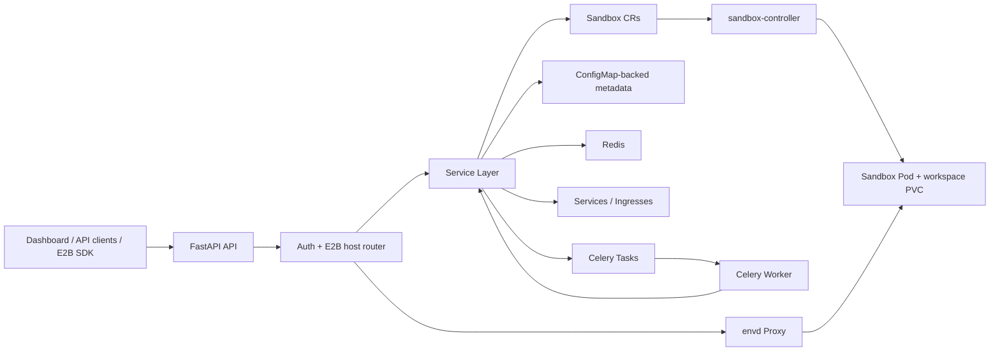

# Litterbox Orchestrator Architecture

## Overview

`orchestrator` is the Python 3.12 backend for the Litterbox sandbox platform. It exposes a FastAPI control plane, uses Celery for asynchronous work, talks to Kubernetes through the official Python SDK, and uses Redis for task transport and lightweight coordination.

At a high level, the service manages five things:

1. Template definitions for sandbox images and resource limits
2. Sandbox lifecycle through `Sandbox` custom resources
3. Warm pool management for pre-created sandboxes
4. Webhook delivery for sandbox events
5. In-sandbox command, file and PTY access through the envd data plane

The codebase is intentionally small and mostly layered:

- `main.py` builds the FastAPI app, middleware and router wiring; `routes/` holds the HTTP transports
- `container.py` wires concrete implementations together
- `services/` contains business orchestration, plus the envd proxy and E2B adapter
- `infra/` wraps Kubernetes and Redis-backed persistence primitives
- `domain/models.py` defines the API and internal data contracts; `domain/e2b_models.py` defines the E2B wire format
- the Go `sandbox-controller` (top-level `controller/`) owns Pod, PVC and TTL reconciliation

## Runtime Topology

The project runs in two process roles:

- `api`: FastAPI + Uvicorn
- `worker`: Celery worker for pool reconciliation and webhook delivery

There is no separate TTL process. The controller schedules a reconcile at
`spec.ttlAnchor + spec.ttlSeconds` and pauses the sandbox itself.



## External Dependencies

- Kubernetes:
  stores `Sandbox` custom resources, runs sandbox Pods and PVCs, and hosts the controller
- Redis:
  Celery broker/result backend and warm-pool locking
- HTTP webhook endpoints:
  external consumers of sandbox lifecycle events
- Prometheus:
  scrapes `/metrics`

The orchestrator does not use a relational database. Persistent control-plane data is stored in Kubernetes `ConfigMap`s and `Sandbox` resources.

## Layering And Responsibilities

### 1. Transport Layer

`routes/` translates HTTP requests into service calls. All REST responses use
the `ApiResponse` envelope. `/e2b` is the E2B-compatible control plane, and the
envd router proxies data-plane traffic to `PodIP:49983`.

### 2. Dependency Wiring

`container.py` builds one `Container` per process:

- `KubernetesGateway` and `SandboxCRDGateway`
- ConfigMap-backed template, pool and webhook repositories
- `SandboxService`, `PoolService`, `ServiceExposeService`
- `WebhookDispatcher` / `WebhookService`
- `EnvdProxyService`
- `E2BControlPlaneService`

### 3. Domain Models

`domain/models.py` contains the REST contracts plus `Template`, `Pool`, `Sandbox`,
`SandboxStatus`, workspace policy and webhook models. `SandboxResponse.from_sandbox`
projects the internal model into the API shape.

### 4. Service Layer

#### `TemplateService`

- creates, lists, updates and deletes template metadata
- persists templates through `TemplateRepository`

#### `SandboxService`

Owns the sandbox lifecycle on top of the `Sandbox` CRD:

- compile a template plus request overrides into a `Sandbox` spec
- create/read/list/update/delete `Sandbox` resources
- map `status.phase` to `SandboxStatus`
- wait for Pod readiness on synchronous create/resume paths
- suspend/resume, lock/unlock and TTL updates via `spec`
- dispatch sandbox lifecycle webhooks
- expose live status counts for the metrics endpoint

It never creates Pods or PVCs. Those are the controller's responsibility.

#### `PoolService`

Implements warm pools on top of `SandboxService`:

- pool definitions live in ConfigMaps and are protected by Redis locks
- reconcile creates sandboxes with `pool-state=creating`, waits for readiness and moves them to `available`
- allocation claims an `available` sandbox and patches it to `allocated`
- release deletes the CR

#### `ServiceExposeService`

- publishes a sandbox port through a Service (and an Ingress for HTTP)
- selects the sandbox Pod with `component=sandbox,app=<sandbox-id>`
- cleans up Service/Ingress resources before the Sandbox CR is deleted

#### `WebhookService` / `WebhookDispatcher`

- webhook definitions live in ConfigMaps
- delivery is asynchronous through Celery
- the dispatcher filters by event type and template, signs requests and retries

#### `EnvdProxyService`

- resolves the running Pod IP for a sandbox
- proxies authenticated HTTP/streaming traffic to port `49983`
- caches Pod IPs briefly and retries GET/HEAD requests on stale addresses

#### `E2BControlPlaneService`

Adapts the REST services to the E2B wire format:

- create -> pool allocation + timeout update
- connect -> resume + timeout update
- pause -> suspend (memory snapshots unsupported)
- kill -> pool release (deletes the CR)
- get -> status projection

### 5. Infrastructure Layer

#### `KubernetesGateway`

- ConfigMap CRUD
- Pod list/read/delete and readiness wait
- Service and Ingress CRUD
- node and RuntimeClass discovery
- secret existence checks
- PVCs are only read indirectly through the controller; the orchestrator does
  not manage them

#### `SandboxCRDGateway`

- create/get/list/patch/delete `litterbox.io/v1alpha1 Sandbox` objects
- merge-patch metadata, spec and status
- wait for a target `status.phase` during control-plane operations

#### ConfigMap Repositories

Templates, pools and webhooks are JSON documents stored in labeled
ConfigMaps. Reads are list/get operations against the Kubernetes API.

## Persistence Model

### Kubernetes

- `Template` -> ConfigMap `template-<id>`
- `Pool` -> ConfigMap `pool-<template-id>`
- `Webhook` -> ConfigMap `webhook-<id>`
- `Sandbox` -> CRD `sandboxes.litterbox.io`
- workspace -> PVC `workspace-<sandbox-id>`, owned by the Sandbox
- exposes -> Service/Ingress labeled with the sandbox id

### Redis

- Celery broker and result backend
- short-lived warm-pool locks (`pool:reconcile:*`, `pool:claim:*`)

## Core Flows

### Template Lifecycle

```text
POST /api/v1/templates
  -> TemplateService.create_template
  -> TemplateRepository.save -> ConfigMap
```

### Direct Sandbox Allocation

```text
POST /api/v1/sandboxes (or POST /e2b/sandboxes)
  -> PoolService.allocate_sandbox
  -> SandboxService.create_sandbox
  -> SandboxCRDGateway.create
  -> sandbox-controller reconciles PVC + Pod
  -> SandboxService waits for Pod ready (direct create)
  -> API returns SandboxResponse
```

The CR spec contains the fully compiled template: image, command, env,
resources, workspace, envd injection, lifecycle hooks, runtime class and TTL.
The controller does not read template ConfigMaps.

### Warm Pool Allocation

```text
allocate
  -> PoolService sees an enabled pool
  -> acquire pool:claim:<template> lock
  -> list pool-state=available CRs
  -> patch the first one to allocated + TTL anchor
  -> release lock, dispatch events, enqueue reconcile

reconcile
  -> create pool-state=creating CRs up to target_ready
  -> wait for each Pod, patch to available
  -> delete excess available / failed CRs
```

### Suspend, Resume, TTL

- suspend patches `spec.state: Paused`; the controller deletes the Pod and
  keeps the PVC
- resume patches `spec.state: Running` and resets `spec.ttlAnchor`; the
  controller recreates the Pod
- `update_ttl` patches `spec.ttlSeconds` and `spec.ttlAnchor`
- `renew_ttl` moves only the expiry by shifting the anchor, preserving the
  configured TTL
- the controller computes `expiresAt = ttlAnchor + ttlSeconds`, requeues at
  that instant, and pauses the sandbox with `status.pausedReason=TTLExpired`
- lock/unlock uses the `litterbox.io/resume-locked` annotation and blocks
  resume in the API

### Delete

```text
SandboxService.delete_sandbox
  -> delete exposes
  -> dispatch sandbox_deleted
  -> delete the Sandbox CR
  -> Kubernetes GC removes Pod and PVC through ownerReferences
```

### envd Data Plane

```text
E2B SDK / dashboard
  -> orchestrator auth
  -> EnvdProxyService
  -> PodIP:49983
```

The path form is `/api/v1/sandboxes/{id}/envd/*`; E2B host routing rewrites
`49983-{id}.{domain}` to the same path. The proxy strips the authorization
header before forwarding.

### Metrics

`/metrics` exposes Prometheus histograms/counters for create events.
`/api/v1/metrics/snapshot` adds in-memory create statistics and live counts
computed from `SandboxService.status_counts()`.

## Testing

- `tests/test_sandbox_crd_backend.py`: CR spec compilation, CRD patches,
  status mapping, suspend/resume, lock/unlock, TTL and status counts
- `tests/test_e2b_control_plane.py`: E2B response mapping
- `tests/test_envd_proxy.py`, `tests/test_e2b_envd_host_routing.py`: proxy and host routing
- `tests/test_config_validation.py`: configuration validators
- `tests/test_webhooks_logging.py`, `tests/test_api_bearer_auth.py`: transport behavior
- `tests/integration/`: FastAPI + Celery + a real Kubernetes cluster with the
  controller installed

`controller/internal/controller/pod_test.go` covers Pod/PVC construction and
status computation. `controller/e2e/e2b_crd_e2e.py` drives the official E2B SDK
against a deployed controller.

## File Map

```text
src/orchestrator/
  main.py                 FastAPI app, auth middleware, E2B host rewrite
  container.py            dependency wiring
  config.py               settings + ORCHESTRATOR__* overrides
  auth.py                 bearer and E2B key checks
  routes/                 REST, E2B, envd, exposes, webhooks, metrics, pools
  services/
    sandboxes.py          Sandbox CR lifecycle
    sandbox_crd.py        CR spec compilation + status projection
    templates.py          template metadata
    pools.py              warm pools
    exposes.py            Service + Ingress
    webhooks.py           webhook metadata + delivery
    envd_proxy.py         data-plane proxy
    e2b.py                E2B control-plane adapter
    metrics.py            create metrics
  infra/
    kubernetes.py         core Kubernetes gateway
    sandbox_crd.py        dynamic client for Sandbox CRs
    repositories.py       ConfigMap repositories
  domain/
    models.py             REST and internal models
    e2b_models.py         E2B wire models
```
