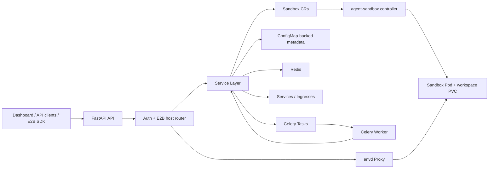

# Litterbox Orchestrator Architecture

## Overview

`orchestrator` is the Python 3.12 backend for the Litterbox sandbox platform. It exposes a FastAPI control plane, uses Celery for asynchronous work, talks to Kubernetes through the official Python SDK, and uses Redis for task transport and lightweight coordination.

At a high level, the service manages five things:

1. Template definitions for sandbox images and resource limits
2. Sandbox lifecycle through `Sandbox` custom resources
3. Warm pool management for pre-created sandboxes
4. Webhook delivery for sandbox events
5. In-sandbox command, file and PTY access through the envd data plane

The codebase is intentionally small and mostly layered:

- `main.py` builds the FastAPI app, middleware and router wiring; `routes/` holds the HTTP transports
- `container.py` wires concrete implementations together
- `services/` contains business orchestration, plus the envd proxy and E2B adapter
- `infra/` wraps Kubernetes and Redis-backed persistence primitives
- `domain/models.py` defines the API and internal data contracts; `domain/e2b_models.py` defines the E2B wire format
- upstream `agent-sandbox` controllers own Pod, PVC and warm-pool reconciliation; the orchestrator writes `SandboxClaim` / `SandboxTemplate` / `SandboxWarmPool` objects and pauses sandboxes whose TTL expired

## Runtime Topology

The project runs in two process roles:

- `api`: FastAPI + Uvicorn
- `worker`: Celery worker for webhook delivery

Warm-pool supply is maintained by the upstream `agent-sandbox` controllers.
TTL is enforced by a sweeper in the `api` process: on expiry it sets the
sandbox to `operatingMode: Suspended`, which deletes the Pod but keeps the PVC.



## External Dependencies

- Kubernetes:
  stores `Sandbox` custom resources, runs sandbox Pods and PVCs, and hosts the controller
- Redis:
  Celery broker/result backend
- HTTP webhook endpoints:
  external consumers of sandbox lifecycle events
- Prometheus:
  scrapes `/metrics`

The orchestrator does not use a relational database. Persistent control-plane data is stored in Kubernetes `ConfigMap`s and `Sandbox` resources.

## Layering And Responsibilities

### 1. Transport Layer

`routes/` translates HTTP requests into service calls. All REST responses use
the `ApiResponse` envelope. `/e2b` is the E2B-compatible control plane, and the
envd router proxies data-plane traffic to `PodIP:49983`.

### 2. Dependency Wiring

`container.py` builds one `Container` per process:

- `KubernetesGateway` and CRD gateways for `Sandbox` / `SandboxClaim` / `SandboxTemplate` / `SandboxWarmPool`
- ConfigMap-backed template and webhook repositories, plus `SandboxPoolRepository`
- `SandboxService`, `PoolService`, `ServiceExposeService`
- `WebhookDispatcher` / `WebhookService`
- `EnvdProxyService`
- `E2BControlPlaneService`

### 3. Domain Models

`domain/models.py` contains the REST contracts plus `Template`, `Pool`, `Sandbox`,
`SandboxStatus`, workspace policy and webhook models. `SandboxResponse.from_sandbox`
projects the internal model into the API shape.

### 4. Service Layer

#### `TemplateService`

- creates, lists, updates and deletes template metadata
- persists templates through `TemplateRepository`

#### `SandboxService`

Owns the sandbox lifecycle on top of `SandboxClaim`:

- compile a template into a `SandboxTemplate` (pod template + PVC template)
- create/read/list/update/delete `SandboxClaim` resources
- map claim/sandbox status to `SandboxStatus`
- wait for Pod readiness on synchronous create/resume paths
- suspend/resume, lock/unlock and TTL updates
- pause sandboxes whose TTL expired (`suspend_expired`, called by the API sweeper)
- dispatch sandbox lifecycle webhooks
- expose live status counts for the metrics endpoint

It never creates Pods or PVCs. The agent-sandbox controller creates the PVC
from `volumeClaimTemplates` and injects it into the Pod.

#### `PoolService`

Warm-pool CRUD and claim on top of `SandboxService`:

- pool definitions are `SandboxWarmPool` custom resources, annotated with the
  original `min_ready` / `max_creating`
- `create_pool` ensures the `SandboxTemplate` exists, then creates or updates
  the warm pool with `replicas = target_ready`
- warm-pool supply and status counts are maintained by the upstream controller
- allocation always creates a `SandboxClaim`; the claim controller adopts a
  warm sandbox when one is ready, otherwise it cold-starts from the template
- an implicit zero-replica warm pool is created for templates without a pool so
  every claim has a `warmPoolRef`; it is hidden from the pool API
- release deletes the CR; the controller observes the delete and replenishes

#### `ServiceExposeService`

- publishes a sandbox port through a Service (and an Ingress for HTTP)
- selects the sandbox Pod with `component=sandbox,app=<sandbox-id>`
- cleans up Service/Ingress resources before the Sandbox CR is deleted

#### `WebhookService` / `WebhookDispatcher`

- webhook definitions live in ConfigMaps
- delivery is asynchronous through Celery
- the dispatcher filters by event type and template, signs requests and retries

#### `EnvdProxyService`

- resolves the running Pod IP for a sandbox
- proxies authenticated HTTP/streaming traffic to port `49983`
- caches Pod IPs briefly and retries GET/HEAD requests on stale addresses

#### `E2BControlPlaneService`

Adapts the REST services to the E2B wire format:

- create -> pool allocation + timeout update
- connect -> resume + timeout update
- pause -> suspend (memory snapshots unsupported)
- kill -> pool release (deletes the CR)
- get -> status projection

### 5. Infrastructure Layer

#### `KubernetesGateway`

- ConfigMap CRUD
- Pod list/read/delete and readiness wait
- Service and Ingress CRUD
- node and RuntimeClass discovery
- secret existence checks
- PVCs are only read indirectly through the controller; the orchestrator does
  not manage them

#### `SandboxCRDGateway`

- create/get/list/patch/delete `agents.x-k8s.io/v1beta1 Sandbox` and
  `extensions.agents.x-k8s.io/v1beta1` objects
- merge-patch metadata, spec and status
- JSON Patch support for callers that need an optimistic `resourceVersion` test

#### `SandboxPoolRepository`

- creates/reads/patches/deletes `SandboxWarmPool` custom resources
- stores `targetReady` in `spec.replicas` and `minReady` / `maxCreating` in
  annotations
- reads controller-written `status` counts and counts allocated claims
- hides implicit zero-replica pools from the pool API

#### ConfigMap Repositories

Templates and webhooks are JSON documents stored in labeled ConfigMaps.

## Persistence Model

### Kubernetes

- `Template` -> ConfigMap `template-<id>`
- `Webhook` -> ConfigMap `webhook-<id>`
- `Template` -> `SandboxTemplate` (`extensions.agents.x-k8s.io`)
- `Sandbox` -> `SandboxClaim`; the claim name is the public sandbox id
- pool -> `SandboxWarmPool`
- workspace -> PVC `workspace-<sandbox-name>`, created from the template's
  `volumeClaimTemplates` and owned by the Sandbox
- exposes -> Service/Ingress labeled with the sandbox id

### Redis

- Celery broker and result backend (webhook delivery)

## Core Flows

### Template Lifecycle

```text
POST /api/v1/templates
  -> TemplateService.create_template
  -> TemplateRepository.save -> ConfigMap
```

### Direct Sandbox Allocation

```text
POST /api/v1/sandboxes (or POST /e2b/sandboxes)
  -> PoolService.allocate_sandbox
  -> SandboxService.create_sandbox
  -> SandboxCRDGateway.create claim
  -> agent-sandbox controller creates PVC + Pod
  -> SandboxService waits for Pod ready (direct create)
  -> API returns SandboxResponse
```

The CR spec contains the fully compiled template: image, command, env,
resources, workspace, envd injection, lifecycle hooks, runtime class and TTL.
The controller does not read template ConfigMaps.

### Warm Pool Allocation

```text
create pool
  -> PoolService ensures SandboxTemplate exists
  -> create/update SandboxWarmPool with replicas = target_ready
  -> agent-sandbox controller creates warm Sandboxes (and their PVCs)

allocate
  -> create SandboxClaim with warmPoolRef
  -> claim controller adopts a ready warm sandbox or cold-starts one
  -> claim becomes the public sandbox id; TTL is written to annotations
```

### Suspend, Resume, TTL

- suspend patches `Sandbox.spec.operatingMode: Suspended`; the controller
  deletes the Pod and keeps the PVC
- resume patches `operatingMode: Running` and resets the TTL anchor; the
  controller recreates the Pod on the same PVC
- `update_ttl` / `renew_ttl` update the claim's `litterbox.io/ttl-seconds` and
  `litterbox.io/ttl-anchor` annotations
- the API sweeper computes `expiresAt = ttlAnchor + ttlSeconds`; when it passes
  it suspends the sandbox and records `litterbox.io/ttl-suspended-at`
- lock/unlock uses the `litterbox.io/resume-locked` annotation and blocks
  resume in the API

### Delete

```text
SandboxService.delete_sandbox
  -> delete exposes
  -> dispatch sandbox_deleted
  -> delete the Sandbox CR
  -> Kubernetes GC removes Pod and PVC through ownerReferences
```

### envd Data Plane

```text
E2B SDK / dashboard
  -> orchestrator auth
  -> EnvdProxyService
  -> PodIP:49983
```

The path form is `/api/v1/sandboxes/{id}/envd/*`; E2B host routing rewrites
`49983-{id}.{domain}` to the same path. The proxy strips the authorization
header before forwarding.

### Metrics

`/metrics` exposes Prometheus histograms/counters for create events.
`/api/v1/metrics/snapshot` adds in-memory create statistics and live counts
computed from `SandboxService.status_counts()`.

## Testing

- `tests/test_agent_sandbox_adapter.py`: pod template, volume claim template,
  claim/TTL mapping and warm-pool repository
- `tests/test_kubernetes_gateway.py`: Pod lookup and readiness helpers
- `tests/test_e2b_control_plane.py`: E2B response mapping
- `tests/test_envd_proxy.py`, `tests/test_e2b_envd_host_routing.py`: proxy and host routing
- `tests/test_config_validation.py`: configuration validators
- `tests/test_webhooks_logging.py`, `tests/test_api_bearer_auth.py`: transport behavior
- `tests/integration/`: FastAPI + Celery + a real Kubernetes cluster with the
  agent-sandbox controllers installed

`tests/test_agent_sandbox_adapter.py` covers the pod template, claim and pool
mapping. End-to-end E2B checks run against the deployed agent-sandbox backend.

## File Map

```text
src/orchestrator/
  main.py                 FastAPI app, auth middleware, E2B host rewrite
  container.py            dependency wiring
  config.py               settings + ORCHESTRATOR__* overrides
  auth.py                 bearer and E2B key checks
  routes/                 REST, E2B, envd, exposes, webhooks, metrics, pools
  services/
    sandboxes.py          Sandbox CR lifecycle
    sandbox_crd.py        CR spec compilation + status projection
    templates.py          template metadata
    pools.py              warm pools
    exposes.py            Service + Ingress
    webhooks.py           webhook metadata + delivery
    envd_proxy.py         data-plane proxy
    e2b.py                E2B control-plane adapter
    metrics.py            create metrics
  infra/
    kubernetes.py         core Kubernetes gateway
    sandbox_crd.py        dynamic client for agent-sandbox CRs
    sandbox_pool_crd.py   SandboxWarmPool repository
    repositories.py       ConfigMap repositories (templates, webhooks)
  domain/
    models.py             REST and internal models
    e2b_models.py         E2B wire models
```
